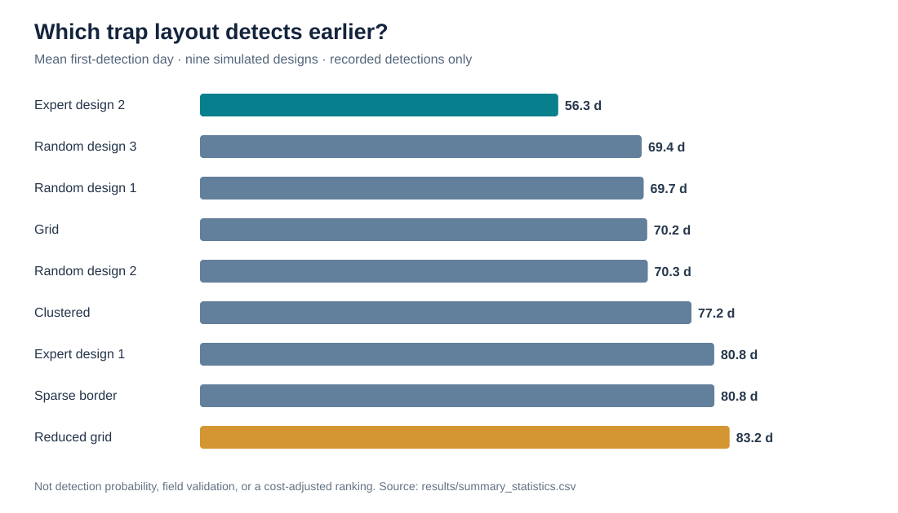
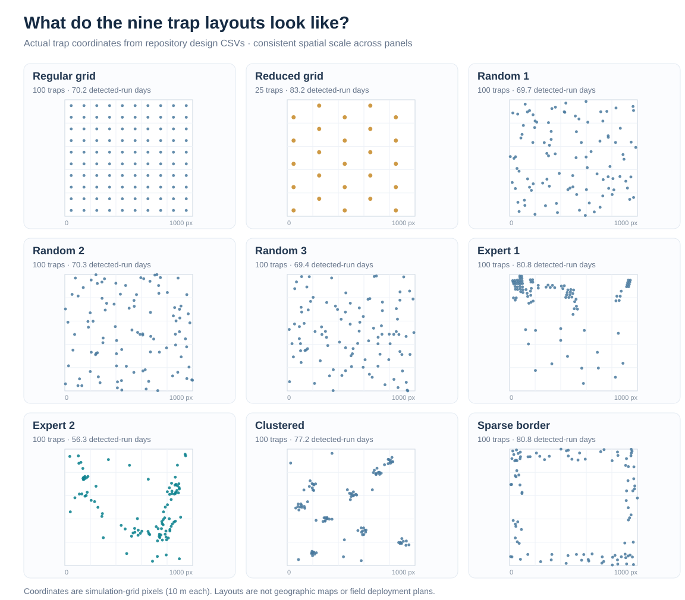

# Spatial Fruit-Fly Surveillance: Comparing Nine Trap-Placement Designs

**Spatial ecological surveillance · Stochastic simulation · Monitoring design evaluation · R**

## Project overview
This project **evaluates nine alternative fruit-fly trap-placement layouts** using a stochastic spread-and-detection simulation with heterogeneous host-tree locations and introduction risk. The decision-support question is: **How does trap placement affect simulated time to first detection?**

This is a **comparative simulation and analysis of supplied and scripted monitoring designs**, not a newly calibrated biological dispersal model or a field-validated optimization system. Some required spatial inputs and model assumptions come from pre-existing objects whose original construction is not documented in this public repository.

## At a glance

| Project metric | Archived evidence |
|---|---|
| Monitoring designs compared | **9** spatial trap layouts |
| Recorded detection outcomes | **18,000** (2,000 per design) |
| Trap effort represented | **25 or 100 traps** per layout |
| Fastest observed conditional mean | **56.26 simulated days** — Expert design 2 (100 traps) |
| Difference versus regular grid | **13.98 days earlier**, among recorded detections |

**Portfolio takeaway:** Simulated first-detection delays varied substantially across trap layouts. Expert design 2 produced the shortest mean detection day in the archived detected-run results; the 25-trap reduced grid used fewer traps but had a longer conditional detection delay. **These comparisons do not establish detection success probabilities, economic efficiency, or real-world optimality.**

### Detection-time comparison



### Spatial trap placement: where are traps located?



**Figure 2 shows spatial placement, not a second detection-time ranking.** Each panel plots the original trap coordinates at the same scale (grid pixels; 10 m per pixel), with the layout's trap count and conditional mean detection day labeled for context. The 25-trap reduced grid can be visually compared with the eight 100-trap alternatives. These are simulation layouts, not field-deployment maps.

Figure 1 summarizes conditional detection times; Figure 2 visualizes trap coordinates and adds those conditional means as annotations. Neither figure reports detection rates. The archived output omits non-detections, and the total number of attempted runs is unavailable.

## Simulation and model provenance
The implementation combines generated and externally supplied inputs:

| Component | What the scripts actually do | Provenance / limitation |
|---|---|---|
| Fruit-fly population profile | `scripts/01_fruitfly_population.R` simulates life stages, resource depletion, adult abundance and female emigration for 1–10 host trees, up to 120 days, producing `allpleave`. | Implemented in the repository; parameters are assumed, not shown as empirically calibrated. |
| Host-tree distribution | `02_calc_distances.R` loads `ntrees`, derives tree coordinates and sizes (`alltrees`), and precomputes 400 nearby trees per host (`allcloseones`). | `ntrees` is an existing spatial object; its generation/source is not included. |
| Introduction-risk surface | `04_run_sim.R` and `05_run_many_sims.R` load `introrisk` and sample introduction locations with probabilities based on this surface. | Pre-existing risk object; source and derivation are not supplied. |
| Dispersal and movement | Female spread uses distance weights `2^(-distance / 50)` and the near-tree list; males move with random directions and stochastic distances. | These are coded simulation assumptions, not a newly estimated or validated field dispersal kernel. |
| Surveillance alternatives | Scripts generate simple grid/random layouts; additional design CSVs include reduced grid, expert, clustered and sparse-border alternatives. | Nine layouts are available for comparison; not all nine designs are shown to be independently generated by this code. |

**Core contribution:** operationalizing and comparing monitoring-layout alternatives under the same stochastic simulation framework, summarizing detection delays, tail behavior, and comparisons across designs.

## Time, distance, and detection definitions
These definitions were checked against the actual scripts:

- **Time unit:** simulated **days**. In `05_run_many_sims.R`, the infection and detection loop advances with `t in 2:400`; when detection occurs, `t` is saved in the output column `time`.
- **Spatial scale:** map coordinates are grid pixels; each pixel is **10 m × 10 m**. Distance calculations convert pixels to meters as required.
- **Detection condition:** a male fly passes within the trap attraction radius (`luredist = 20` meters) of at least one trap.
- **Repeated-run settings:** `nruns = 100` per design in the shown batch script; `male.max.age = 36` days and `mmdd = 300` meters/day. The single-run illustration in `04_run_sim.R` instead sets `mmdd = 100` meters/day; single-run and batch settings should not be treated as identical.
- **Simulation horizon:** maximum loop index 400 days. The batch script records rows **only when detection occurs**; therefore exported summaries may exclude non-detection runs. Mean detection times should be interpreted as **conditional on detected runs**, unless detection coverage is independently audited.

## Results: nine trap-placement designs
Reported means and standard deviations are transcribed from [`results/summary_statistics.csv`](results/summary_statistics.csv). Values are **simulation days to detection for recorded detections**, not empirically observed field outcomes.

| Design | Mean detection day | SD |
|---|---:|---:|
| Grid | 70.24 | 10.53 |
| Reduced grid | 83.16 | 14.79 |
| Random design 1 | 69.67 | 10.95 |
| Random design 2 | 70.32 | 11.79 |
| Random design 3 | 69.36 | 10.88 |
| Expert design 1 | 80.76 | 14.12 |
| **Expert design 2** | **56.26** | **13.43** |
| Clustered design | 77.18 | 16.93 |
| Sparse-border design | 80.79 | 16.29 |

All nine archived results files contain **2,000 recorded detections each** (18,000 total). This does **not** establish a 100% detection rate, because the total number of attempted runs and any non-detections were not retained. The batch script presently sets `nruns=100`, so the provenance of the 2,000 archived rows per design (e.g., combined batches) also needs documentation. In the current design CSVs, **Reduced grid has 25 traps**, while **each other design has 100**. See [verified descriptive comparison](results/trap_effort_detection_comparison.csv) and [recomputation script](scripts/10_compare_trap_effort.R).

Within the recorded simulation outputs, **Expert design 2 has the shortest mean detection time** and Reduced grid the longest. Expert design 2 is **13.98 days earlier** on average than the 100-trap Grid; the 25-trap Reduced grid is **12.93 days later** on average than Grid. This does **not** establish that Expert design 2 is a universally optimal trap network: trap counts, placement budgets, undetected replicate frequencies, and parameter sensitivity must also be compared before drawing operational conclusions.

### Outputs available
- [Detection-time comparison chart](figures/detection_time_comparison.svg) and [trap-effort comparison chart](figures/trap_effort_tradeoff.svg)
- [Detection-time summary](results/summary_statistics.csv)
- [90th-percentile summaries](results/percentile_90.csv) and [99th-percentile summaries](results/percentile_99.csv)
- [Bonferroni-adjusted pairwise t-test table](results/pairwise_t_test_results.csv)
- [Simulation figures](results/) and [monitoring design CSV inputs](data/)

The pairwise-comparison script explicitly specifies `p.adjust.method = "bonferroni"`. These tests still depend on independence and sampling assumptions; extremely small p-values are not substitutes for effect-size, detection-rate or design-cost analysis.

## Repository layout
```text
scripts/
  01_fruitfly_population.R
  02_calc_distances.R
  03_make_grid_design.R
  04_run_sim.R
  05_run_many_sims.R
  06_show_design.R
  07_plot_hist_density.R
  08_result summary.R
  09_CDF with confidence intervals.R
data/         # Nine alternative designs and supporting CSV files
results/      # Detection-time records, summary statistics, percentiles, tests, figures
outputs/      # Saved visualizations
figures/      # Recruiter-facing comparison charts (SVG)
docs/         # Supporting scientific context and original report
```

## Reproducibility status
**Partial reproduction only with the public repository.** The scripts retain machine-specific working directories and assume that R objects such as `ntrees` and `introrisk` exist locally. Some intermediate outputs (`alltrees`, `allcloseones`, `allpleave`) must first be generated, and the files are not all bundled. Do not expect a fresh clone to run end-to-end without obtaining and validating the missing spatial inputs.

Recommended reconstruction sequence, **once the required inputs have been obtained**:
1. Run `01_fruitfly_population.R` to derive `allpleave`.
2. Run `02_calc_distances.R` with the `ntrees` object to derive host-tree and neighbor data.
3. Select or build a monitoring-design CSV and ensure all spatial coordinates follow the same 10-meter grid convention.
4. Configure `05_run_many_sims.R` to run a chosen design, controlling stochastic seed and parameter settings; retain detection and non-detection counts separately.
5. Summarize detection outcomes and percentiles, accounting for non-detection/censoring before comparing strategies.

To recalculate trap counts and detection summaries directly from the archived CSVs, run `Rscript scripts/10_compare_trap_effort.R` from the repository root. This writes a more detailed `results/trap_effort_detection_comparison.csv` including observed-detection quantiles; it deliberately marks detection probability as unavailable.

Before a rigorous rerun, parameterize file paths, document the origins of `ntrees` and `introrisk`, add explicit random seeds, retain every simulation replicate (including failures to detect by day 400), and calculate detection probability alongside conditional detection time.

## Applied significance and limitations
The work illustrates an important conservation and biosecurity question: **where should limited monitoring effort be deployed when introduction risk and host distributions are spatially heterogeneous?** This decision framing is relevant to ecological surveillance design, including biodiversity-monitoring organizations.

However, the experiments concern simulated fruit-fly trapping, not observed species-occurrence monitoring at NatureServe; transfer to biodiversity field programs would require an appropriate ecological observation model, effort constraints, site access, detection uncertainty and validation.

## Scientific context
The repository includes a scientific reference on spatially heterogeneous local-scale surveillance (Triska, *Pest Management Science*, 2018). This reference informs the project context; the current repository does not establish that its own input layers or parameter values were independently derived or empirically validated.

[Environmental & Climate Data Science Portfolio](https://ys30.github.io/)
